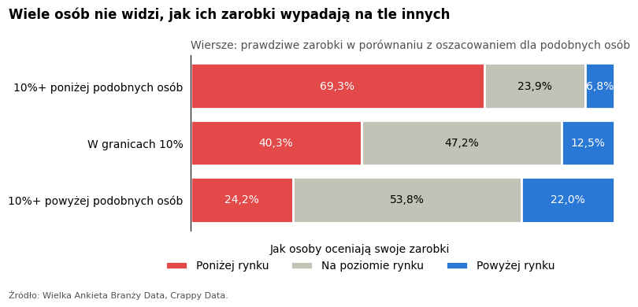
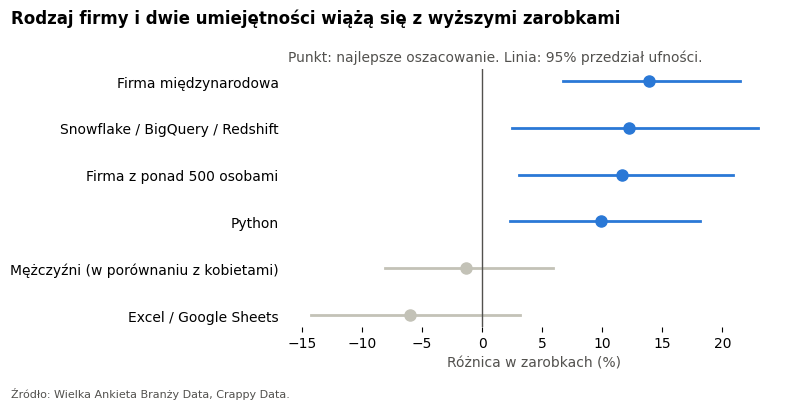

# Ile jesteś wart? Zarobki w branży danych

**Czy wiesz, czy zarabiasz uczciwie?** W ankiecie wśród osób pracujących z danymi 45% osób czuje, że zarabia poniżej rynku, a tylko 14% czuje, że zarabia powyżej. Ten projekt sprawdza, co naprawdę wiąże się z wyższymi zarobkami i czy ludzie znają swoją wartość na rynku.

**[Otwórz pełną analizę](pay_in_data_jobs_pl.ipynb)**



## Historia w czterech krokach

1. **Jakie czynniki wiążą się z zarobkami?** Testy statystyczne (Kruskal-Wallis, wielkość efektu, korekta Holma).
2. **Co zostaje, gdy porównujemy podobne osoby?** Regresja liniowa na logarytmie zarobków, ze sprawdzeniem założeń i wyników.
3. **Jak dobrze możemy przewidzieć zarobki?** Uczenie maszynowe: Ridge, Lasso, drzewo decyzyjne, Random Forest, XGBoost i LightGBM, porównane walidacją krzyżową.
4. **Czy ludzie znają swoją wartość na rynku?** Model szacuje zarobki podobnych osób, a my porównujemy je z prawdziwymi zarobkami i z odczuciem każdej osoby.

## Najważniejsze wyniki

- **Najważniejsze są poziom stanowiska i forma zatrudnienia.** Testy, regresja i uczenie maszynowe są zgodne.
- **Pracodawca ma znaczenie.** Firmy międzynarodowe płacą o około 12-14% więcej niż podobnym osobom płacą firmy polskie.
- **Python wiąże się z wyższymi zarobkami.** Osoby, które go używają, zarabiają o około 10-12% więcej niż podobne osoby. To związek, a nie udowodniona przyczyna.
- **Brak wyraźnej różnicy** dla kierunku wykształcenia i płci wśród podobnych osób.
- **Zarobki można przewidzieć tylko częściowo.** Najlepsze modele osiągają R² około 0,5 przy typowym błędzie około 23%. Najdokładniejszy był dostrojony boosting, ale proste modele liniowe były blisko. Domyślny XGBoost mocno się przeuczył.
- **Wiele osób nie widzi swojej pozycji.** Spośród osób zarabiających co najmniej 10% więcej niż podobne osoby tylko 22% czuje, że zarabia powyżej rynku, a 24% nadal czuje, że zarabia poniżej.



## Dane

Dane pochodzą z **Wielkiej Ankiety Branży Data** przygotowanej przez **Crappy Data**. W ankiecie wzięło udział 297 osób pracujących z danymi. Analiza używa 264 z nich.

**Zarobki** to średnie miesięczne zarobki na rękę w złotych. Osoby miały podzielić roczny dochód przez 12, po odjęciu wszystkich podatków i składek ZUS.

**Surowych danych nie ma w tym repozytorium**, bo zasady korzystania z danych nie pozwalają ich publikować. Notatnik pokazuje tylko wyniki dla grup i ukrywa grupy mniejsze niż 5 osób.

## Struktura projektu

```text
pay-in-data-jobs-pl/
├── pay_in_data_jobs_pl.ipynb    Pełna analiza z wynikami
├── images/                      Wykresy użyte w tym README
├── requirements.txt             Pakiety Pythona
└── README.md
```

## Jak uruchomić

Notatnik i wszystkie wyniki można przeczytać na GitHubie bez uruchamiania czegokolwiek.

Żeby uruchomić go ponownie, potrzebujesz własnego dostępu do danych z ankiety. Umieść pliki CSV w folderze `data` obok folderu projektu:

```text
twój-folder/
├── data/                        Pliki CSV z ankiety (nie ma ich w tym repozytorium)
└── pay-in-data-jobs-pl/
```

Następnie zainstaluj pakiety i otwórz notatnik:

```bash
pip install -r requirements.txt
jupyter notebook pay_in_data_jobs_pl.ipynb
```

Porównanie modeli trwa kilka minut.

## Źródło

Źródło: Wielka Ankieta Branży Data, Crappy Data.
